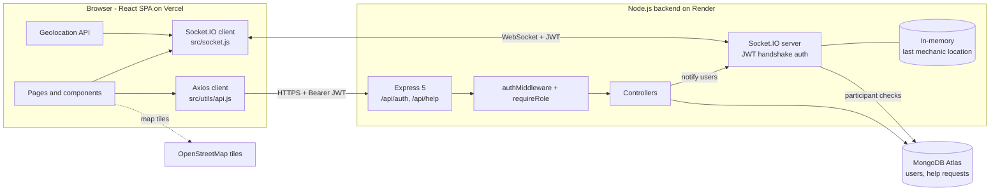
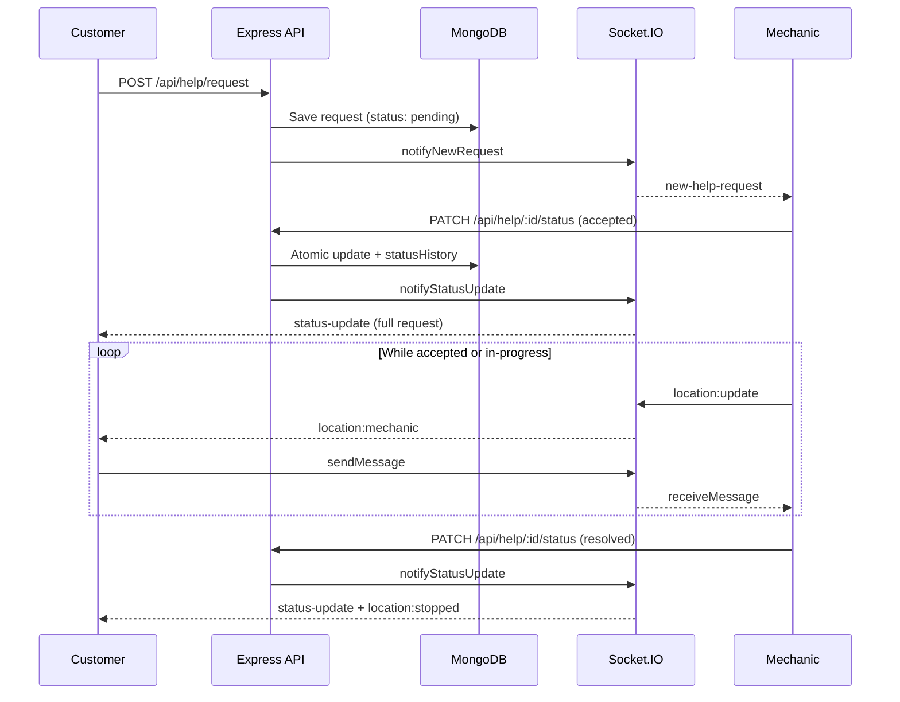

<div align="center">

# RoadResQ

**RoadResQ — Help when you need it. Tracked every step.**

A full-stack roadside assistance platform that connects stranded drivers with nearby mechanics, with live GPS tracking, real-time chat and instant status updates.

[](https://react.dev/)
[](https://vite.dev/)
[](https://tailwindcss.com/)
[](https://nodejs.org/)
[](https://expressjs.com/)
[](https://socket.io/)
[](https://mongoosejs.com/)
[](https://leafletjs.com/)

[Live Demo](https://roadresq-lime.vercel.app/) · [Backend API](https://roadresq-backend-025b.onrender.com) · [Repository](https://github.com/rajatbaranwal/roadresq)

</div>

---

## Table of Contents

- [Overview](#overview)
- [Live Application](#live-application)
- [Features](#features)
- [Technology Stack](#technology-stack)
- [Architecture](#architecture)
- [Folder Structure](#folder-structure)
- [Getting Started](#getting-started)
- [Environment Variables](#environment-variables)
- [API Reference](#api-reference)
- [Real-Time Architecture](#real-time-architecture)
- [Deployment](#deployment)
- [Testing](#testing)
- [Security Considerations](#security-considerations)
- [Known Limitations](#known-limitations)
- [Future Enhancements](#future-enhancements)
- [Author](#author)

---

## Overview

A breakdown on the road is stressful. Most of the stress comes from not knowing: has anyone seen my request, who is coming, and where are they now? Phone calls to roadside services rarely answer those questions.

RoadResQ makes the whole process visible from start to finish:

1. A **customer** describes the problem (service type, vehicle, urgency, details) and pins their location using GPS or by tapping a map.
2. Every available **mechanic** gets the request instantly on their dashboard.
3. A mechanic **accepts** the job. The customer is notified immediately, and both sides can now see each other's contact details.
4. While the job is active, the mechanic's **live GPS position** streams to the customer's map and the two can **chat in real time**.
5. The mechanic moves the job through **In progress** to **Resolved**. Each step is timestamped on the customer's timeline. Chat and location sharing close automatically when the job ends.

### Objectives

- Get a help request in front of mechanics within seconds.
- Remove uncertainty for the customer with a live status timeline and real-time mechanic location.
- Protect privacy: contact details and live location are shared only between the customer and the one mechanic who accepted the job, and only while the job is active.
- Use real data only: no simulated movement, fake ETAs or invented statistics.

---

## Live Application

| | URL |
|---|---|
| Frontend (Vercel) | https://roadresq-lime.vercel.app/ |
| Backend API (Render) | https://roadresq-backend-025b.onrender.com |
| Repository | https://github.com/rajatbaranwal/roadresq |

> The backend root (`/`) returns `API is running...`. All API routes are under `/api`.

---

## Features

### Accounts and access
- **Registration and login** for two roles, **customer** (`user`) and **mechanic** (`mechanic`), using name, email, phone and password.
- **JWT authentication**: tokens are valid for 7 days; when one expires, the user is logged out automatically.
- **Role-based authorization** on the server (`requireRole` middleware) and in the client (role-guarded routes). Each role lands on its own dashboard.
- Case-insensitive email login and duplicate-email protection.
- Rate limiting on the auth endpoints (20 attempts per 15 minutes per IP by default).

### Customer experience
- **Request form** with seven service types (flat tyre, battery jump-start, fuel delivery, towing, lockout, engine trouble, other), vehicle type, urgency (Low / Medium / High) and a description.
- **Location picker** (Leaflet + OpenStreetMap): use the device GPS or tap the map to set a position.
- **Customer dashboard** with active and past requests.
- **My Requests** page with a **status timeline** (Request created → Accepted → In progress → Resolved) showing when each step happened.
- **Live tracking panel**: the assigned mechanic's position moves smoothly on the map, with a GPS accuracy circle, distance and a "last updated" time.

### Mechanic experience
- **Mechanic dashboard** with Incoming, Active and Completed tabs.
- **Live counters** computed by the database: available, accepted, in progress and completed.
- **Accept, decline, start and resolve** requests. Declining hides the request from that mechanic only.
- Concurrency-safe acceptance: if two mechanics accept at the same moment, exactly one wins and the other gets a clear conflict message.
- **Availability toggle**: go offline to stop receiving new-request alerts.
- **GPS location sharing** for the active job, plus Google Maps links to the customer's location.

### Real-time communication (Socket.IO)
- Authenticated socket connection using the same JWT as the REST API.
- **New requests** pushed instantly to available mechanics.
- **Status updates** pushed instantly to the customer and the assigned mechanic.
- **One-to-one chat** between the customer and the assigned mechanic, with delivery acknowledgements and retry for failed messages.
- **Typing indicators**.
- **Live mechanic GPS** delivered only to that job's customer.
- Automatic reconnection with session recovery after brief network drops.

### Notifications
- In-app **notification panel** with unread count, mark-as-read and clear-all.
- **Toasts** for new requests, status changes and new messages.
- Optional **sound alerts** (preference saved per browser).
- Browser (desktop) notifications while the tab is in the background, if the user has already granted notification permission.

### Interface
- Responsive layouts for mobile, tablet and desktop.
- Custom design system (Tailwind tokens, Space Grotesk + Inter typography) with micro-interactions that respect the user's reduced-motion setting.
- Route-level code splitting: maps, chat and dashboards load on demand.

---

## Technology Stack

| Layer | Technologies |
|---|---|
| **Frontend** | React 19, React Router 7, Vite 7, Tailwind CSS 3 (PostCSS, Autoprefixer), Lucide React icons, Axios |
| **Backend** | Node.js, Express 5, dotenv, CORS |
| **Database** | MongoDB (MongoDB Atlas in production), Mongoose 8 |
| **Authentication and security** | JSON Web Tokens (`jsonwebtoken`), `bcryptjs` password hashing, role middleware, in-memory rate limiter |
| **Real-time communication** | Socket.IO 4.8 (server) and `socket.io-client` 4.8 (browser) |
| **Maps and geolocation** | Leaflet 1.9, React Leaflet 5, OpenStreetMap tiles, browser Geolocation API |
| **Tooling and testing** | ESLint 9, Node.js built-in test runner (`node:test`), `mongodb-memory-server`, `socket.io-client` |
| **Deployment and hosting** | Vercel (frontend), Render (backend), MongoDB Atlas (database) |

---

## Architecture

The React single-page app talks to the Express backend in two ways:

- **REST over HTTPS** (Axios) for authentication and for creating, reading and updating help requests.
- **A persistent Socket.IO connection** for everything that must arrive instantly: new requests, status changes, chat, typing indicators and live location.

Both channels are authenticated with the same JWT. REST controllers write to MongoDB and then use the shared Socket.IO server to notify the right users. Live GPS positions never touch the database; the server keeps only the latest position per active job in memory.



### Request lifecycle



---

## Folder Structure

```text
roadresq/
├── README.md
├── .gitignore
├── roadresq_backend/
│   ├── server.js                 # Entry point: env checks, DB connection, listen, graceful shutdown
│   ├── app.js                    # Builds Express app + HTTP server + Socket.IO (shared with tests)
│   ├── config/
│   │   └── db.js                 # Mongoose connection
│   ├── controllers/
│   │   ├── authController.js     # Register and login
│   │   └── helpController.js     # Help request CRUD, status transitions, stats
│   ├── middlewares/
│   │   ├── authMiddleware.js     # JWT verification (REST + socket)
│   │   ├── roleMiddleware.js     # requireRole('user' | 'mechanic')
│   │   └── rateLimit.js          # In-memory per-IP rate limiter
│   ├── models/
│   │   ├── User.js
│   │   └── HelpRequest.js        # Statuses, transitions, service types, indexes
│   ├── routes/
│   │   ├── authRoutes.js         # /api/auth
│   │   └── helpRoutes.js         # /api/help
│   ├── socket/
│   │   └── index.js              # Socket auth, rooms, chat, typing, location, notifications
│   ├── test/
│   │   └── integration.test.js   # REST + Socket.IO integration tests
│   ├── .env.example
│   └── package.json
└── roadresq_frontend/
    ├── index.html
    ├── vite.config.js            # Dev proxy for /api and /socket.io
    ├── tailwind.config.js        # Design tokens and animations
    ├── vercel.json               # SPA rewrites (static assets excluded)
    ├── .env.example
    ├── .env.production           # Public production URLs used by `vite build`
    ├── public/                   # Favicon and notification sound
    ├── package.json
    └── src/
        ├── main.jsx
        ├── App.jsx               # Routes (lazy-loaded) and providers
        ├── socket.js             # Shared Socket.IO client
        ├── chatStore.js          # Session chat history store
        ├── index.css
        ├── components/
        │   ├── ui/               # Button, Badge, StatusTimeline, feedback states
        │   ├── map/              # TrackingMap, LocationPicker, marker icons
        │   ├── requests/         # Customer request cards, live tracking panel
        │   ├── mechanic/         # Incoming request and active job cards
        │   ├── Chat.jsx
        │   ├── Navbar.jsx
        │   ├── NotificationPanel.jsx
        │   ├── AuthLayout.jsx
        │   └── Footer.jsx
        ├── context/              # AuthContext, NotificationContext, ToastContext
        ├── hooks/                # useSocket, useLocation, useMyRequests
        ├── services/             # locationShare (mechanic GPS), availability
        ├── pages/                # Home, Login, Register, dashboards, HelpRequest, MyRequests, ChatPage, MechanicList
        ├── routes/               # PrivateRoute, RoleRoute, GuestRoute
        └── utils/                # api, status, format, routes helpers
```

---

## Getting Started

### Prerequisites

- **Node.js 20.19 or newer** (Vite 7 requires 20.19+ or 22.12+) and npm.
- A **MongoDB** database: a free [MongoDB Atlas](https://www.mongodb.com/atlas) cluster, or a local MongoDB server.
- Git.

### 1. Clone the repository

```bash
git clone https://github.com/rajatbaranwal/roadresq.git
cd roadresq
```

### 2. Install backend dependencies

```bash
cd roadresq_backend
npm install
```

### 3. Configure backend environment variables

```bash
cp .env.example .env
```

Edit `roadresq_backend/.env` and set at least `MONGO_URI` and `JWT_SECRET` (see [Environment Variables](#environment-variables)). You can generate a strong secret with:

```bash
node -e "console.log(require('crypto').randomBytes(48).toString('hex'))"
```

### 4. Start the backend

```bash
npm run dev     # with nodemon (auto-restart), if installed globally
# or
npm start       # plain node
```

The API runs on `http://localhost:5050` by default. Opening it in a browser shows `API is running...`.

> `npm run dev` calls `nodemon`, which is not a project dependency. Install it with `npm install -g nodemon` or use `npm start`.

### 5. Install frontend dependencies

Open a second terminal at the repository root:

```bash
cd roadresq_frontend
npm install
```

### 6. Configure frontend environment variables

No frontend configuration is needed for local development. With `VITE_API_URL` and `VITE_SOCKET_URL` left empty, the Vite dev server proxies `/api` and `/socket.io` to `http://127.0.0.1:5050`.

If your backend runs elsewhere, create a local env file:

```bash
cp .env.example .env.local
# then set DEV_BACKEND_URL, e.g. DEV_BACKEND_URL=http://127.0.0.1:5050
```

> `.env.production` is used only by `npm run build`. It does not affect `npm run dev`.

### 7. Start the frontend

```bash
npm run dev
```

Open `http://localhost:5173`. To try the full flow, register one **customer** and one **mechanic** account in two different browsers (or one normal and one private window), since each window keeps its own session.

> Geolocation needs a secure context. `localhost` counts as secure; to test on a phone over your LAN you need HTTPS.

---

## Environment Variables

### Backend (`roadresq_backend/.env`) — server-side secrets

These stay on the server. Never commit `.env`; it is already excluded by `.gitignore`.

| Variable | Required | Default | Description |
|---|---|---|---|
| `MONGO_URI` | Yes | — | MongoDB connection string. The server exits on startup if missing. |
| `JWT_SECRET` | Yes | — | Secret used to sign and verify JWTs. Use a long random value. The server exits on startup if missing. |
| `PORT` | No | `5050` | HTTP port. Render sets this automatically. |
| `CLIENT_ORIGIN` | No | `http://localhost:5173` | Comma-separated list of allowed frontend origins, applied to both REST CORS and Socket.IO CORS. |
| `TRUST_PROXY` | No | `0` | Set to `1` behind a reverse proxy (Render) so rate limiting sees each client's real IP. |
| `SOCKET_DEBUG` | No | `0` | Set to `1` to log every socket event. |
| `AUTH_RATE_LIMIT` | No | `20` | Max login/register attempts per IP per 15 minutes. |

Example with placeholders only:

```env
MONGO_URI=mongodb+srv://<user>:<password>@<cluster>/<database>
JWT_SECRET=<long-random-string>
PORT=5050
CLIENT_ORIGIN=http://localhost:5173
TRUST_PROXY=0
SOCKET_DEBUG=0
```

### Frontend (`roadresq_frontend`) — public build configuration

Variables starting with `VITE_` are **embedded into the JavaScript bundle and visible to anyone**. Use them only for public URLs and flags. Never put secrets in them.

| Variable | Used in | Description |
|---|---|---|
| `VITE_API_URL` | Production build | Base URL of the REST API, **including `/api`**, e.g. `https://<backend-host>/api`. Empty means `/api` (dev proxy). |
| `VITE_SOCKET_URL` | Production build | Origin of the Socket.IO server, **without a path**, e.g. `https://<backend-host>`. Empty means same origin (dev proxy). |
| `VITE_SOCKET_DEBUG` | Optional | Set to `1` to log socket events in a production build. They are always logged in development. |
| `DEV_BACKEND_URL` | `vite.config.js` only | Backend that the dev proxy forwards to (default `http://127.0.0.1:5050`). Not included in the bundle. |

`roadresq_frontend/.env.production` is committed on purpose because it contains only these public URLs:

```env
VITE_API_URL=https://<backend-host>/api
VITE_SOCKET_URL=https://<backend-host>
```

---

## API Reference

Base URL: `https://<backend-host>/api` (locally `http://localhost:5050/api`).

Authenticated routes need the header `Authorization: Bearer <token>`. All responses are JSON. Errors have the form `{ "message": "..." }` with status codes `400` (validation), `401` (missing, invalid or expired token), `403` (wrong role or not a participant), `404`, `409` (conflict) and `429` (rate limited).

### Authentication — `/api/auth`

| Method | Endpoint | Auth | Description |
|---|---|---|---|
| `POST` | `/api/auth/register` | Public, rate limited | Create an account |
| `POST` | `/api/auth/login` | Public, rate limited | Log in |

**`POST /api/auth/register`**

```json
{
  "name": "Asha",
  "email": "asha@example.com",
  "phone": "9876543210",
  "password": "at-least-6-chars",
  "role": "user"
}
```

`role` is optional: `"user"` (customer, the default) or `"mechanic"`. All other fields are required, and the password needs at least 6 characters. On success it returns `201`:

```json
{
  "message": "User registered successfully",
  "user": { "id": "...", "name": "...", "email": "...", "phone": "...", "role": "user" },
  "token": "<jwt>"
}
```

**`POST /api/auth/login`** takes `{ "email": "...", "password": "..." }` and returns `200` with the same `user` and `token` shape. Wrong credentials return `401`.

### Help requests — `/api/help`

Every route below requires authentication.

| Method | Endpoint | Role | Description |
|---|---|---|---|
| `POST` | `/api/help/request` | Customer | Create a help request |
| `GET` | `/api/help/mine` | Customer | The customer's own requests, newest first (up to 200) |
| `GET` | `/api/help/all` | Mechanic | Open requests plus requests assigned to this mechanic, excluding ones they declined. Optional `?limit=` (default 100, max 200) |
| `GET` | `/api/help/stats` | Mechanic | Dashboard counters |
| `GET` | `/api/help/:id` | Participant | One request: its customer, its assigned mechanic, or any mechanic while it is unassigned |
| `PATCH` | `/api/help/:id/accept` | Mechanic | Accept a pending request (same as setting status to `accepted`) |
| `PATCH` | `/api/help/:id/status` | Mechanic | Move a request to the next status |
| `PATCH` | `/api/help/:id/reject` | Mechanic | Decline a pending request (hidden for this mechanic only) |

**`POST /api/help/request`**

```json
{
  "vehicleType": "Car",
  "description": "Front left tyre is flat",
  "location": "28.6139,77.2090",
  "urgency": "High",
  "serviceType": "flat-tyre"
}
```

| Field | Required | Rules |
|---|---|---|
| `vehicleType` | Yes | String, max 50 characters |
| `description` | Yes | String, max 1000 characters |
| `location` | Yes | String, max 200 characters. The frontend sends `"lat,lng"`. |
| `urgency` | No | `Low`, `Medium` (default) or `High` |
| `serviceType` | No | `flat-tyre`, `battery`, `fuel`, `towing`, `lockout`, `engine`, `other` |

The customer's phone is taken from their account. Returns `201` with `{ "message": "Help request submitted", "helpRequest": { ... } }` and notifies available mechanics in real time.

**`PATCH /api/help/:id/status`** takes `{ "status": "accepted" | "in-progress" | "resolved" }`. Only these transitions are allowed:

```text
pending → accepted → in-progress → resolved
```

The first mechanic to accept is assigned to the request; after that, only the assigned mechanic can advance it. Each transition is recorded in `statusHistory` with a timestamp. Returns `{ "message": "...", "helpRequest": { ... } }`. An invalid transition returns `400`, another mechanic's job returns `403`, and a concurrent update returns `409`.

**`PATCH /api/help/:id/reject`** returns `{ "message": "Request declined", "requestId": "..." }`. Only pending requests can be declined; anything else returns `409`.

**`GET /api/help/stats`** returns:

```json
{ "stats": { "available": 3, "accepted": 1, "inProgress": 0, "completed": 12 } }
```

### Data visibility

| Data | Customer (owner) | Assigned mechanic | Other mechanics |
|---|---|---|---|
| Request details, vehicle and location | Yes | Yes | Only while the request is pending |
| Customer name | Yes | Yes | Yes (pending requests) |
| Customer phone and email | Yes | Yes | No |
| Mechanic name and phone | Yes | Yes | — |
| Which mechanics declined | No | No | No (server-side only) |

---

## Real-Time Architecture

### Connection and authentication
- The client connects only after login (`autoConnect: false`) and sends the JWT in the handshake (`auth.token`). The token is read again on every reconnect attempt.
- The server verifies the token in `io.use(...)` middleware and rejects missing, invalid or expired tokens (`UNAUTHORIZED` / `TOKEN_EXPIRED`). When this happens, the client logs the user out.
- The identity attached to each socket (`socket.data.user`) comes from the verified token, never from event payloads, so senders cannot be spoofed.

### Rooms
| Room | Members | Used for |
|---|---|---|
| `user:<userId>` | Every connected tab or device of that user | Targeted delivery: status updates, chat, typing, location |
| `mechanics` | Mechanics who are currently available | New-request broadcasts |

Rooms are joined on the server from the token on every connection; clients never choose their own rooms.

### Events

**Client → server** (handlers marked "ack" reply through a Socket.IO acknowledgement callback):

| Event | Sent by | Payload | Behaviour |
|---|---|---|---|
| `sendMessage` | Customer or assigned mechanic | `{ requestId, message }` | Ack `{ ok, message, delivered }`. Allowed only while the request is `accepted` or `in-progress`; max 1000 characters; 20 messages per 10 seconds. |
| `typing` | Either participant | `{ requestId, isTyping }` | Forwarded to the other participant only. |
| `location:update` | Assigned mechanic | `{ requestId, lat, lng, accuracy?, heading?, speed? }` | Ack. Coordinates validated; at most one update every 2 s; only for the mechanic's own active job. |
| `location:get` | Either participant | `{ requestId }` | Ack with the last known position (or `null`), so a customer who opens the page later sees the mechanic immediately. |
| `location:stop` | Assigned mechanic | `{ requestId }` | Ack. Stops sharing and notifies the customer. |
| `mechanic:availability` | Mechanic | `{ available }` | Ack. Joins or leaves the `mechanics` room. |

**Server → client:**

| Event | Received by | Payload |
|---|---|---|
| `new-help-request` | Available mechanics | The new request, without customer contact details |
| `status-update` | Customer and assigned mechanic | `{ requestId, newStatus, mechanicId, request }` (full request) |
| `status-update` | Other available mechanics | `{ requestId, newStatus, mechanicId }` (summary only, so they can remove it from their list) |
| `receiveMessage` | The other participant, and the sender's other tabs | `{ requestId, senderId, senderName, senderRole, message, sentAt }` |
| `typing` | The other participant | `{ requestId, userId, name, isTyping }` |
| `location:mechanic` | That job's customer only | `{ requestId, lat, lng, accuracy, heading, speed, updatedAt }` |
| `location:stopped` | Job participants | `{ requestId, reason }`: sent when sharing stops or the job leaves the active statuses |

### Live location sharing
- When a mechanic has an accepted or in-progress job, the browser reads real GPS positions with `navigator.geolocation.watchPosition`.
- Updates are sent at most every 4 s and only after moving at least 10 m, with a 20 s heartbeat so "last updated" stays current.
- The customer's map animates a single marker between positions instead of re-creating it.
- The server keeps only the latest position per active job, in memory. It is never written to MongoDB and is deleted when the job is resolved, when sharing stops, or after one hour without updates.

### Notifications
The frontend `NotificationContext` listens for `new-help-request` (mechanics), `status-update` and `receiveMessage` and turns them into toasts, notification-panel entries, optional sounds and background browser notifications. Notifications and chat history last for the current browser session.

### Connection and reconnection
- The client tries WebSocket first and falls back to HTTP long-polling.
- Socket.IO **connection state recovery** (up to 2 minutes) restores rooms and missed events after short network drops.
- After a longer outage or a server restart, the client reconnects with a fresh handshake, the server re-joins rooms from the token, and pages refetch their data over REST so nothing is missed.
- On logout, the socket disconnects and location sharing and chat state are cleared.

---

## Deployment

The backend and frontend deploy separately from the same repository. Deploy the backend first, because the frontend needs its URL.

### Backend — Render (Web Service)

| Setting | Value |
|---|---|
| Root directory | `roadresq_backend` |
| Runtime | Node (20 or newer) |
| Build command | `npm install` |
| Start command | `npm start` |
| Instances | 1 (see [Known Limitations](#known-limitations)) |

**Environment variables** (Render → Service → Environment):

| Variable | Value |
|---|---|
| `MONGO_URI` | Your MongoDB Atlas connection string |
| `JWT_SECRET` | A long random secret |
| `CLIENT_ORIGIN` | Your frontend origin, e.g. `https://roadresq-lime.vercel.app` |
| `TRUST_PROXY` | `1` |

Do not set `PORT`; Render provides it.

**MongoDB Atlas**
1. Create a cluster and a database user with read/write access.
2. Under **Network Access**, allow connections from Render. Render's outbound IPs are listed on your service's **Connect** tab; alternatively allow `0.0.0.0/0` and rely on strong credentials.
3. Copy the `mongodb+srv://...` connection string into `MONGO_URI` on Render.

**CORS and `CLIENT_ORIGIN`**

`CLIENT_ORIGIN` controls which websites may call the API and open a Socket.IO connection. It must match the browser's origin exactly: scheme and host, no trailing slash, no path.

When the frontend domain changes (for example, a new Vercel project or a custom domain):

1. Open Render → your service → **Environment**.
2. Update `CLIENT_ORIGIN`. To allow several origins, separate them with commas:
   ```env
   CLIENT_ORIGIN=https://roadresq-lime.vercel.app,https://www.example.com
   ```
3. Save. Render redeploys the service with the new value.

If the origin is missing, browsers block requests with a CORS error and the socket cannot connect.

### Frontend — Vercel

| Setting | Value |
|---|---|
| Root directory | `roadresq_frontend` |
| Framework preset | Vite |
| Build command | `npm run build` |
| Output directory | `dist` |
| Node.js version | 20.x or 22.x |

**Production URLs.** The build reads `VITE_API_URL` and `VITE_SOCKET_URL` from `roadresq_frontend/.env.production`. You can override them in Vercel → Project → Settings → Environment Variables; values set there take precedence over the file.

```env
VITE_API_URL=https://roadresq-backend-025b.onrender.com/api
VITE_SOCKET_URL=https://roadresq-backend-025b.onrender.com
```

`VITE_API_URL` must end with `/api`, because every backend route lives under it. `VITE_SOCKET_URL` is the bare origin. These values are baked in at build time, so redeploy the frontend after changing them.

**Client-side routing.** `vercel.json` rewrites app routes such as `/login` and `/dashboard/mechanic` to `index.html`, so page refreshes and deep links work. Files under `/assets/` and any path with a file extension are served as-is.

### Deployment checklist
- [ ] Backend deployed on Render with `MONGO_URI`, `JWT_SECRET`, `CLIENT_ORIGIN` and `TRUST_PROXY=1`.
- [ ] Atlas network access allows Render.
- [ ] `https://<backend-host>/` returns `API is running...`.
- [ ] Frontend `VITE_API_URL` ends with `/api`, and `VITE_SOCKET_URL` is the backend origin.
- [ ] `CLIENT_ORIGIN` on Render matches the Vercel domain exactly.
- [ ] Register, log in and create a request on the live site.

---

## Testing

### Backend integration tests

```bash
cd roadresq_backend
npm test
```

The suite in [`roadresq_backend/test/integration.test.js`](roadresq_backend/test/integration.test.js) starts the real Express + Socket.IO app against an **in-memory MongoDB** (`mongodb-memory-server`), so it doesn't need a database or any `.env` values. The first run downloads a MongoDB binary, so it needs internet access.

The 28 tests cover:
- Authentication: validation, case-insensitive login, duplicate emails, and error responses that don't leak internals.
- REST role checks and participant-only access.
- Socket handshake authentication: missing, invalid and expired tokens.
- New-request broadcasts reaching mechanics only, and status updates with full vs. summary payloads.
- Chat: participant-only delivery, sender spoofing prevention, delivery acknowledgements, typing indicators.
- Live location: mechanic-to-customer only, validation, throttling, and cleanup when the job is resolved.
- Mechanic availability, stats, decline privacy, and concurrent acceptance (exactly one mechanic wins).
- Reconnection with session recovery, re-joining rooms after a fresh connection, and cleanup on disconnect.

### Frontend lint and build

```bash
cd roadresq_frontend
npm run lint      # ESLint
npm run build     # production build into dist/
npm run preview   # serve the production build locally
```

> There are currently no automated frontend tests.

---

## Security Considerations

| Area | Implementation |
|---|---|
| **JWT authentication** | Tokens are signed with `JWT_SECRET` and expire after 7 days. Every protected REST route and every socket connection verifies the token and checks that the user still exists. |
| **Password hashing** | Passwords are hashed with bcrypt (10 salt rounds) and never returned by the API. |
| **Role-based access control** | `requireRole` enforces customer-only and mechanic-only routes. Status changes check ownership in an atomic database update, so a mechanic can't modify another mechanic's job. |
| **Data minimisation** | Mechanics see a customer's phone and email only after accepting that job. The list of mechanics who declined a request is never sent to clients. |
| **Input validation** | Required fields, enums, lengths, ObjectIds and coordinates are validated on the server. JSON bodies are capped at 100 KB, and malformed JSON returns `400`. |
| **Rate limiting** | Login and registration are limited per IP. Chat messages, typing and location updates are throttled per socket. |
| **Environment variables** | Secrets live only in the backend `.env` (git-ignored) or the hosting provider's settings. The frontend contains only public `VITE_*` URLs. The server refuses to start without `MONGO_URI` and `JWT_SECRET`. |
| **CORS** | REST and Socket.IO accept only the origins in `CLIENT_ORIGIN`. |
| **Socket authentication** | Handshake JWT verification. Identity and rooms come from the token, never from client input. Every chat and location event re-checks that the sender belongs to the request. |
| **Controlled GPS sharing** | Only the assigned mechanic can share location, only for an `accepted` or `in-progress` job, and only that job's customer receives it. Positions are kept in memory only and deleted when the job ends. |

---

## Known Limitations

- **Mechanic accounts are not verified.** Anyone can register as a mechanic. While a request is pending, every mechanic can see the customer's first name, vehicle, description and pinned location (but not their contact details).
- **Tokens are stored in `localStorage`.** This is simple, but readable by any script running on the page.
- **Session-only chat and notifications.** Messages and notifications are not saved in the database and disappear on refresh or logout.
- **Single instance.** Live locations, socket rooms and rate-limit counters are held in memory, so the backend must run as a single instance.
- **"Find mechanics" page** (`/mechanics`) shows clearly labelled placeholder listings; there is no mechanic directory or geo-search API yet.
- **Map tiles** come from OpenStreetMap's public tile server, which is not intended for heavy production traffic.
- **Hosting cold starts.** On Render's free plan the backend sleeps when idle, so the first request after a pause can take noticeably longer.

---

## Future Enhancements

- Mechanic verification and an admin approval workflow.
- Persistent chat history and notifications stored in MongoDB.
- Redis adapter for Socket.IO and a shared rate-limit store to support multiple backend instances.
- httpOnly cookie sessions with refresh tokens, and re-validation of long-lived socket connections.
- A real mechanic directory with geospatial search (MongoDB `2dsphere`) and distance-based request matching.
- Route-based ETAs from a routing service.
- Web push notifications that work when the app is closed.
- Ratings and reviews after a job is resolved.
- Frontend component and end-to-end tests, plus a CI pipeline running lint, tests and build on every pull request.
- A production map tile provider.

---

## Author

**Rajat Baranwal**

GitHub: [@rajatbaranwal](https://github.com/rajatbaranwal)
